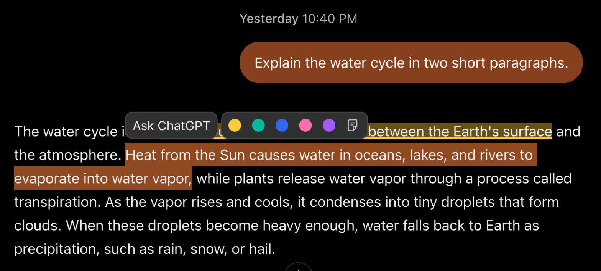
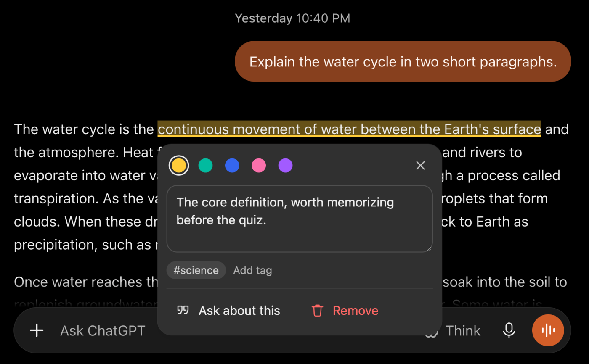
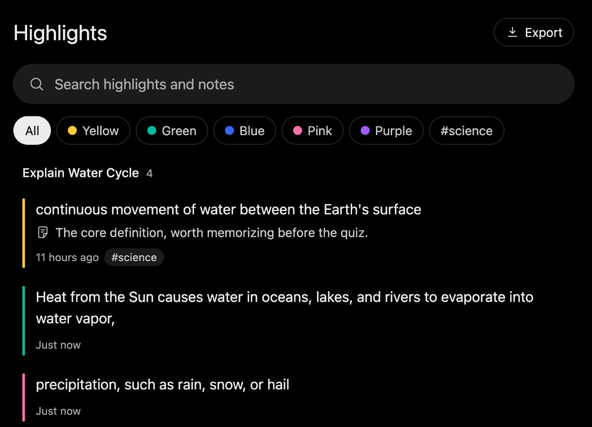

# Highlights for ChatGPT

Highlights for ChatGPT is a Chrome and Firefox extension that lets you highlight passages inside ChatGPT answers, attach notes and tags, and find everything again in a Highlights view that opens inside ChatGPT itself. Highlights are painted with the CSS Custom Highlight API, so the extension never changes the markup of a conversation, and a highlight survives a reload, navigation and ChatGPT re-rendering a message. It needs Chrome 128 or later, or Firefox 140 or later.

A selection made with the keyboard gets the same pill, so Shift and the arrow keys select, Tab moves into the pill, Enter or Space picks a color or the note button, and Escape dismisses it.







## Install

The extension is built from source with pnpm. It needs Node 22.22.2 or later on Node 22, Node 24.15 or later on Node 24, or Node 26 or later. Install the dependencies and build both browsers.

```sh
pnpm install
pnpm build
```

The build writes one unpacked extension per browser under `dist`. In Chrome, open `chrome://extensions`, turn on developer mode, choose Load unpacked and select `dist/chrome-mv3`. In Firefox, open `about:debugging#/runtime/this-firefox`, choose Load Temporary Add-on and select `dist/firefox-mv3/manifest.json`. A temporary Firefox add-on is removed when the browser closes. A permanent install needs the Firefox zip from `pnpm zip` signed through addons.mozilla.org.

## Develop

`pnpm dev` starts WXT with hot reload in Chrome and `pnpm dev:firefox` does the same in Firefox. Both open a browser with the extension loaded and rebuild it when a source file changes.

Every change has to pass `pnpm check`, which runs the type check, Biome, the standards script and the unit tests with their coverage thresholds. `pnpm bundle` builds both browsers and verifies the content script budget of 28 KiB gzipped with no zod or IndexedDB code in it. `pnpm e2e:firefox` builds the Firefox extension and loads it into a real Firefox 140 or later through Marionette, which checks that the build installs and mounts its overlay on a chatgpt.com page. It is opt-in because it needs Firefox installed and openssl, and `docs/firefox-testing.md` explains why. The `video` folder is a separate project and stays out of the type check, Biome and the standards script. `pnpm e2e` builds the Chromium extension in the `e2e` mode and runs the Playwright specs in the light and dark themes. The `e2e` build is the only one whose shadow root is open, because Playwright cannot reach into a closed root, and it lands in `dist/chrome-mv3-e2e` so it never replaces the shipped build. The first run may need `pnpm exec playwright install chromium`.

The specs serve a ChatGPT-shaped page at `https://chatgpt.com` through request interception, built from the same HTML fixtures the unit tests use, together with a mock session endpoint and a mock conversation endpoint. The performance spec restores 100 highlights across 50 messages and reads the `hl:anchor` measure that the e2e build records around every anchoring pass, whether it runs when a conversation loads or in a later flush, and it stays under 8 ms.

## Architecture

The extension has a background and a content script that talk through typed messages. The background is the only owner of IndexedDB, because a database created by the content script would belong to the chatgpt.com origin where the page could read it, and it validates every request with zod, applies the write and tells every ChatGPT tab which conversations changed. The content script runs in an isolated world with one MutationObserver and one requestAnimationFrame flush, and the flush anchors messages as they finish rendering, which during generation means every message except the one being written, retries a quote it could not place after 250 ms, 1 s and 4 s because ChatGPT renders some messages in stages, keeps the sidebar entry in place and resolves a pending jump to a highlight. Everything the user sees lives in one Shadow DOM host rendered with Preact, using only ChatGPT's own design tokens so that light and dark themes apply without theme code. Code is split into domain folders under `src` (`model`, `anchoring`, `painter`, `chatgpt`, `retention`, `storage`, `messaging`, `ui` and a few more) that may only import each other along the edges listed in `EDGES` in `scripts/standards/config.mjs`, and `docs/standards.md` holds the rules that `pnpm check` enforces.

## Privacy

Everything stays in your browser. Highlighting is off in ChatGPT's temporary chats, because ChatGPT keeps those chats out of your history and the extension follows suit by saving nothing from them. ChatGPT's own page scripts can see which passages are painted and whether a passage has a note, because the CSS Custom Highlight registry is shared with the page, but they cannot read the text of notes or tags, which live only in the extension's database and its closed overlay. Highlights, notes and tags are stored in IndexedDB owned by the extension, and nothing is sent to any server of ours, because there is no server, no account and no telemetry. The only network requests are two kinds of same-origin request to chatgpt.com. One reads your existing ChatGPT session, and the other asks whether a saved conversation still exists, at most once an hour per conversation and only when the Highlights view opens. Both carry your own session exactly as the ChatGPT page itself would. The extension asks for the `unlimitedStorage` and `alarms` permissions and for host access to `https://chatgpt.com/*`, and the Firefox manifest declares that it collects no data. Backups are plain JSON files that you export and restore yourself from the Export menu.

## Firefox and AMO review

`pnpm zip` writes three files to `dist`, the Chrome package, the Firefox package and a Firefox sources zip for the AMO source review. Reviewers can rebuild the Firefox package from the sources zip with Node 22.12 or later and pnpm 10 by running `pnpm install` and then `pnpm build`, which writes `dist/firefox-mv3` byte for byte equal to the uploaded package. The sources zip is built from an allow list, which is `src` without its test files, `public`, `assets`, `scripts`, the package manifest, the lockfile, the TypeScript and WXT configs, the README and the license. The icons in `public/icons` and their SVG sources in `assets` are generated by `pnpm icons` from `HIGHLIGHTER_ICON` and the default highlight color in `src/model`, so a change to the icon starts there. The script needs `rsvg-convert` from librsvg.

`pnpm lint:firefox` runs `web-ext lint` on `dist/firefox-mv3` and reports zero errors. It prints three warnings that reviewers can safely dismiss.

`UNSAFE_VAR_ASSIGNMENT` points at an `innerHTML` assignment in the content script bundle. It comes from Preact's `dangerouslySetInnerHTML` path, which this code never reaches, and the standards script bans `dangerouslySetInnerHTML`, `innerHTML` and the other raw HTML injection APIs in all shipped code under `src`.

`KEY_FIREFOX_ANDROID_UNSUPPORTED_BY_MIN_VERSION` says the minimum version would apply to Firefox for Android, where `data_collection_permissions` needs 142. The manifest declares no `gecko_android` key on purpose, so the extension is not offered on Android, where it has not been tested.

`DANGEROUS_EVAL` points at the background bundle. It comes from the feature probe in zod 4, which calls `Function("")` inside a try block to learn whether the browser allows string evaluation. The extension configures zod as jitless before any schema is built, so the probe never runs and the browser never sees a string evaluation, which leaves the warning as a static match on code that is present in the bundle but unreachable. The extension never evaluates a string of its own.
